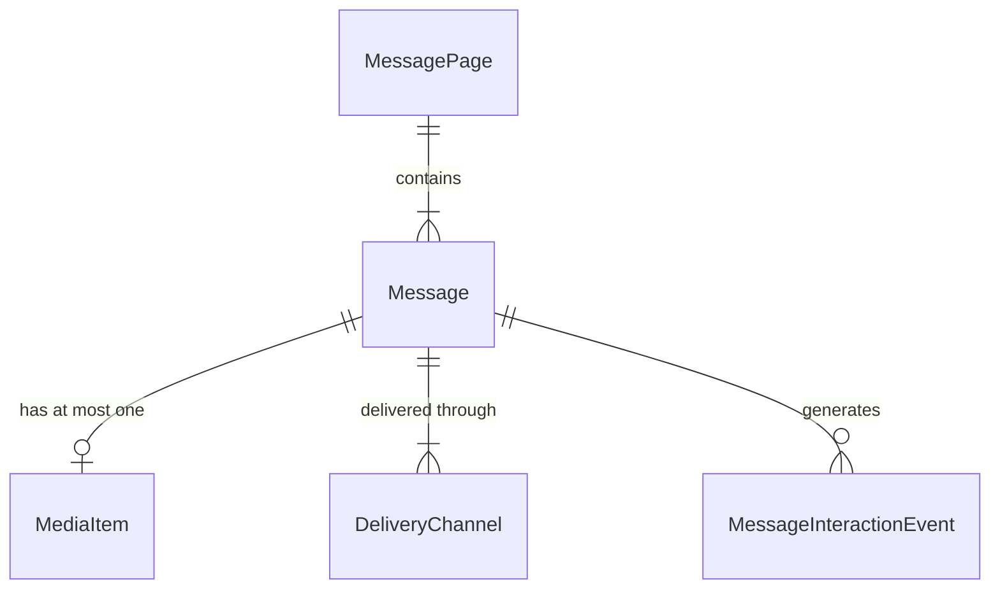

# Data Model: Message Management — Mobile Experience

**Feature**: `001-message-notifications` | **Date**: 2026-08-04

This describes the client-side shape of the entities named in [spec.md](spec.md). All server-owned entities live in the React Query cache; only the popup dismissal set is persisted locally. Types belong in `types/message.type.ts`.

---

## Message

The unit a Storekeeper reads. Produced by the portal, resolved and targeted by the backend.

| Field              | Type                          | Required | Notes                                                                                                    |
| ------------------ | ----------------------------- | -------- | -------------------------------------------------------------------------------------------------------- |
| `id`               | `string`                      | yes      | Stable identifier. Also the routing key in the FCM `data` payload.                                       |
| `title`            | `string`                      | yes      | Rendered in list, detail, popup and banner.                                                              |
| `body`             | `string`                      | yes      | Plain text. Rendered in detail and popup.                                                                |
| `publishedAt`      | `string` (ISO 8601)           | yes      | Drives newest-first ordering and month grouping.                                                         |
| `endDate`          | `string` (ISO 8601) \| `null` | yes      | `null` means no expiry. Backend decides which tab a message lands in; the app does not recompute expiry. |
| `channels`         | `DeliveryChannel[]`           | yes      | Non-empty. Informational on the client — the backend already filtered each surface's list.               |
| `media`            | `MediaItem` \| `null`         | yes      | At most one (FR-014).                                                                                    |
| `acknowledgeLabel` | `string` \| `null`            | yes      | `null` means no acknowledgement action (FR-016). Sender-authored, already localised by the portal.       |
| `isRead`           | `boolean`                     | yes      | Server-owned. Never optimistically mutated (FR-019).                                                     |
| `isAcknowledged`   | `boolean`                     | yes      | Compatibility field mapped from `IsRead` for Inbox DTOs; not a push-open flag. Popup/banner acknowledgement uses separate endpoints (FR-017a). |
| `isExpired`        | `boolean`                     | yes      | Server-computed (`IsExpired`); never derived from the device clock. Always `false` for pop-ups/banners.  |

### Validation rules (client-side, defensive only)

- `media` is ignored if `media.url` is empty; the detail view then renders text only (FR-013).
- `acknowledgeLabel` that is present but blank is treated as `null` — no action is rendered.
- An unknown value in `channels` is ignored rather than throwing, so a new portal channel cannot break the inbox.

### Derived client state (not stored)

- **Month group key** — `dayjs(publishedAt).format('YYYY-MM')`, used for FR-003 grouping.
- **Unread styling** — `!isRead && !isExpired` (FR-004). Expired messages always render as read.

### State transitions

```
Inbox: unread --Mark as read (channel=Inbox)--> read
Inbox: unread --open detail / push tap-------> unread
Push:  notification tap --channel=Push-------> push-open interaction
Popup/banner: active --channel acknowledgement--> acknowledged (removed)
```

- Inbox read is server-confirmed. A failed read leaves the row unread and surfaces an error (FR-019a).
- A push-open interaction is separate from Inbox read state; it neither changes `isRead` locally nor invalidates the Inbox/detail/unread-count queries. Failure is recorded through Crashlytics and does not block navigation (FR-022a).
- Popup/banner acknowledgements use their own endpoints, not the Inbox read endpoint. Banner removal waits for confirmation; popup dismissal closes immediately (FR-026, FR-029a).
- `acknowledged` is terminal: the action is disabled once `isAcknowledged` is `true`.

---

## MediaItem

The single optional attachment.

| Field          | Type                 | Required | Notes                                                                                        |
| -------------- | -------------------- | -------- | -------------------------------------------------------------------------------------------- |
| `type`         | `'image' \| 'video'` | yes      | Selects `expo-image` vs `expo-video`.                                                        |
| `url`          | `string`             | yes      | Absolute, backend-hosted.                                                                    |
| `thumbnailUrl` | `string` \| `null`   | yes      | Poster frame for video; used as the list/banner preview. `null` falls back to a placeholder. |

### Constraints (enforced by the portal, assumed by the app)

- Image: PNG or JPG, ≤ 5 MB.
- Video: MP4, ~1 minute guidance, ≤ 30 MB.

The app performs no validation of size or codec. A media load failure degrades to text-only rendering (FR-013).

---

## DeliveryChannel

```ts
type DeliveryChannel = 'push' | 'inbox' | 'popup' | 'banner';
```

| Value    | Mobile surface                                         |
| -------- | ------------------------------------------------------ |
| `push`   | FCM notification, and the message appears in the Inbox |
| `inbox`  | The message appears in the Inbox                       |
| `popup`  | Modal overlay on Home                                  |
| `banner` | Home banner / carousel                                 |

A message carries one or more. Per Clarification 1 and FR-001a the backend, not the app, decides which messages each endpoint returns; the client never filters by channel.

---

## MessageInteractionEvent

A write-only record. There is no client-side representation beyond the mutation payload.

| Field       | Type                      | Notes                               |
| ----------- | ------------------------- | ----------------------------------- |
| `messageId` | `string`                  | Target message.                     |
| `type`      | `'read' \| 'push-open' \| 'acknowledge'` | Conceptual interaction; not a request-body field. |
| `channel`   | `MessageChannels` | Required query parameter for `/Inbox/{messageId}/read`; omitted from popup/banner acknowledgement endpoints. |

- Sent exactly once per user action. Never queued, never retried locally (FR-019a).
- `channel=Inbox` confirms an Inbox read; `channel=Push` records a push open independently. The app does not send an Inbox confirmation alongside a push open.
- Popup/banner acknowledgement does not produce an Inbox read event (FR-017a).

### MessageChannels

```ts
enum MessageChannels {
  Inbox = 'Inbox',
  Push = 'Push',
}
```

These are API interaction-source values, not the lowercase `DeliveryChannel` labels. The service requires an explicit channel; there is no default.

---

## MessagePage

The paginated envelope returned by the inbox endpoints (FR-003a).

| Field        | Type        | Notes                                                              |
| ------------ | ----------- | ------------------------------------------------------------------ |
| `items`      | `Message[]` | Already ordered newest first by the backend.                       |
| `page`       | `number`    | 1-based index of this page.                                        |
| `pageSize`   | `number`    | Echoed back for cursor arithmetic.                                 |
| `totalCount` | `number`    | Total across all pages for the tab.                                |
| `hasMore`    | `boolean`   | Drives `getNextPageParam`; when `false`, `useInfiniteQuery` stops. |

---

## UnreadCount

| Field         | Type     | Notes                                                                                                 |
| ------------- | -------- | ----------------------------------------------------------------------------------------------------- |
| `unreadCount` | `number` | Rendered as the bell badge (FR-006). Refetched on foreground and after any read/acknowledge mutation. |

---

## PopupDismissalState (client-only, persisted)

Owned by `useMessagePopupStore` (Zustand + `immer` + `persist` → AsyncStorage).

| Field          | Type       | Notes                                                                            |
| -------------- | ---------- | -------------------------------------------------------------------------------- |
| `dismissedIds` | `string[]` | Message ids the Storekeeper has dismissed or acknowledged from a popup (FR-026). |

- Cleared on logout together with all other message state (FR-035).
- This is the only message-related data persisted on the device. No server entity is duplicated into Zustand (Constitution III).

---

## Entity relationships


